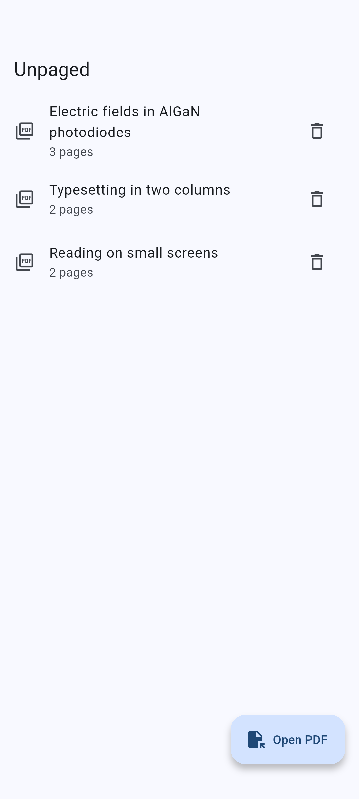
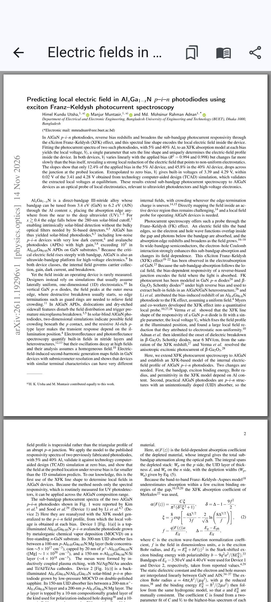
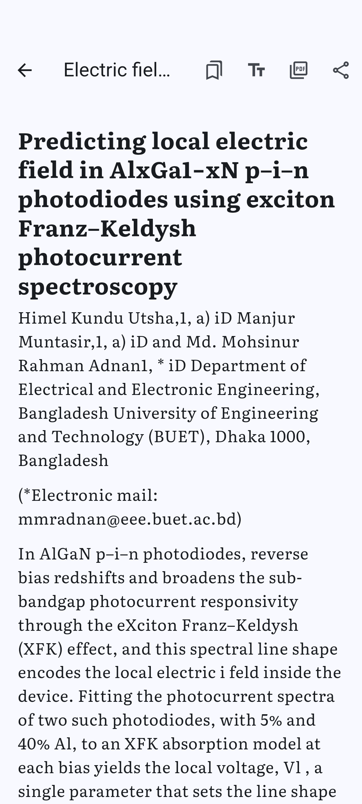
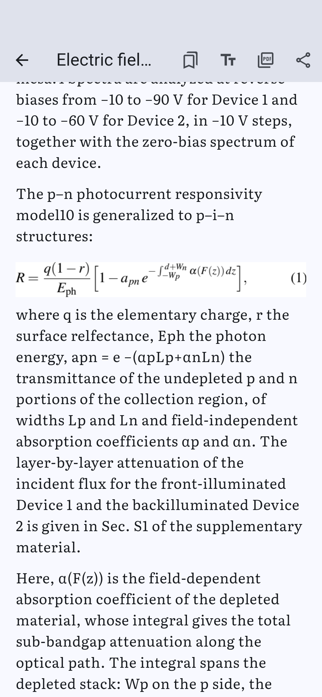
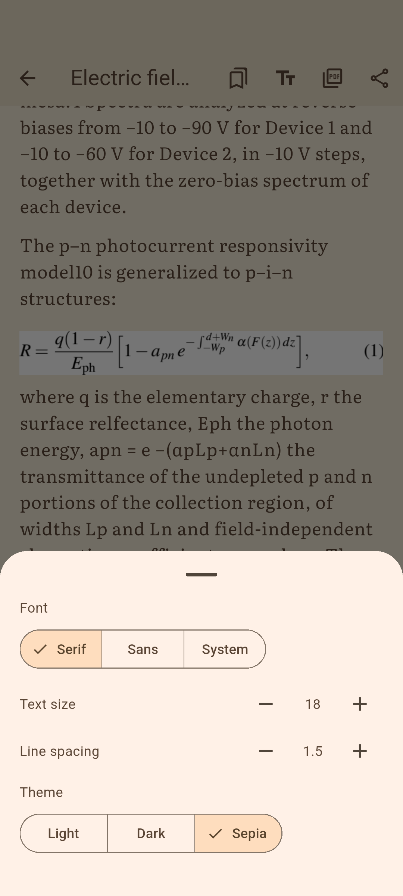
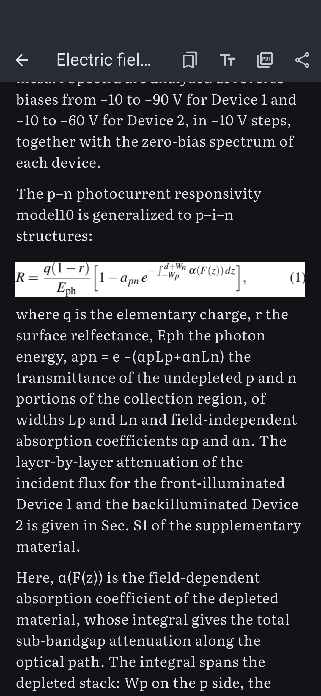

<div align="center">


# Unpaged

**A PDF reader for Android that turns papers and technical PDFs into eBooks you can actually read on a phone.**

Fully offline · open source (MIT) · no accounts, no tracking

[](https://github.com/SphaeroX/unpaged/actions/workflows/android.yml)
[](https://github.com/SphaeroX/unpaged/actions/workflows/screenshots.yml)
[](LICENSE)

</div>

PDFs are made for paper. On a phone that means tiny fonts, two columns and endless zooming and panning. Unpaged opens every PDF in its original layout and, for PDFs with a text layer, also offers an **eBook mode**: the text is reflowed like an EPUB, in your font, size and theme. Tables, figures and formulas stay exactly as they were, as crisp crops of the original page that you can tap to zoom.

Everything happens on the device. Unpaged has no network access, no analytics and no crash reporter.

## Screenshots

<!-- The images are recaptured by .github/workflows/screenshots.yml on every app change. -->

| Library | Original page | eBook mode |
|:---:|:---:|:---:|
|  |  |  |
| **Figures as crops** | **Reading settings** | **Dark theme** |
|  |  |  |

## Features

- **Original view** – the PDF exactly as published, with smooth zooming.
- **eBook mode** – offline reflow of PDFs with a text layer, including two-column papers: reading order across columns, running headers and page numbers removed, hyphenation resolved, headings, lists and captions recognised.
- **Tables, figures and formulas as images** – cut from the original page instead of being garbled into text; tap to open a zoomable view.
- **Background preparation** – the eBook version is computed once after import and cached; progress is shown in the library.
- **Library with reading progress** – continue where you stopped, in the view you used last.
- **Reading settings** – serif (Literata), sans (Atkinson Hyperlegible) or system font, text size, line spacing, light / dark / sepia theme.
- **Highlights and notes** – in both views, stored only inside the app; your PDF is never modified.
- **Share and print** the original PDF.
- **Import** via the file picker, "Open with" and "Share" from other apps.
- English and German user interface.

Not supported on purpose: scanned PDFs without a text layer (no OCR), cloud sync, AI features, writing annotations into the PDF.

## Install

Download the latest APK from [Releases](https://github.com/SphaeroX/unpaged/releases) and open it on your phone (Android 7.0 or newer). A Google Play release is planned.

## How eBook mode works

```
PDF ──► pdfrx / PDFium ──► glyphs with positions ──► reflow_engine ──► blocks ──► reader
                                                     lines · columns · reading order
                                                     headers/footers · regions
                                                     paragraphs · headings · hyphenation
```

1. On import the PDF is copied into the app (its SHA-256 is the document ID).
2. The PDF adapter extracts every glyph with its position via [pdfrx](https://pub.dev/packages/pdfrx) (PDFium).
3. The layout analysis in [`packages/reflow_engine`](packages/reflow_engine) – a pure Dart package without Flutter or PDF dependencies – groups glyphs into lines, finds columns and the reading order, drops running headers and page numbers, detects tables, figures and formulas, and builds headings, paragraphs, list items and captions.
4. Regions are rendered once as PNG crops; the result is stored as JSON together with the engine version and recomputed when the engine improves.

The engine is tested against snapshots of a corpus of openly licensed papers. Details: [docs/architecture.md](docs/architecture.md).

## Building from source

Requirements: Flutter (stable, 3.50 or newer), Java 21 and the Android SDK.

```bash
git clone https://github.com/SphaeroX/unpaged.git
cd unpaged
flutter pub get
flutter run                          # on a connected device or emulator
flutter build apk --release          # build/app/outputs/flutter-apk/app-release.apk
```

Without signing secrets the release APK is signed with the debug key, which is fine for testing.

### Tests

Tests live in `tests/` (not `test/`), so paths are always given explicitly:

```bash
flutter test tests/app tests/reflow_engine     # unit, widget and engine tests
flutter test tests/integration -d <device-id>  # integration tests on a device/emulator
flutter analyze && dart format .
```

### Screenshots

The images above are produced by [`tests/screenshots/screenshots_test.dart`](tests/screenshots/screenshots_test.dart). The [Screenshots workflow](.github/workflows/screenshots.yml) runs it on an Android emulator whenever the app changes on `main` (or manually from the Actions tab) and commits the new images to `docs/screenshots/`, so this README always shows the current app. To capture them locally:

```bash
flutter drive --driver=tests/screenshots/driver.dart --target=tests/screenshots/screenshots_test.dart -d <device-id>
```

## Project structure

| Path | Content |
|---|---|
| `lib/features/` | App features: library, import, viewer (original), reader (eBook), reflow, annotations, settings, share |
| `lib/core/` | Database (drift), PDF adapter (the only place that uses pdfrx), file storage, theming, platform channels |
| `packages/reflow_engine/` | Layout analysis as a pure Dart package |
| `tests/` | Unit, widget, engine (snapshot), integration and screenshot tests |
| `docs/` | Architecture, testing, code style and conventions (German) |
| `Roadmap/` | Task planning |

## Contributing

Issues and pull requests are welcome. The project follows strict test-driven development and keeps its documentation in [`docs/`](docs/) up to date; the rules for humans and coding agents are in [AGENTS.md](AGENTS.md). In short:

- Write a failing test first, then the code.
- No network access and no dependency without an MIT-compatible licence (no GPL/AGPL, no MuPDF).
- Commit messages follow [Conventional Commits](https://www.conventionalcommits.org/).

## License

Unpaged is released under the [MIT License](LICENSE).

### Credits

- PDF rendering and text extraction: [pdfrx](https://pub.dev/packages/pdfrx) with [PDFium](https://pdfium.googlesource.com/pdfium/).
- Fonts: [Literata](https://github.com/googlefonts/literata) and [Atkinson Hyperlegible](https://www.brailleinstitute.org/freefont/), SIL Open Font License 1.1.
- The paper in the screenshots is the first three pages of H. K. Utsha, M. Muntasir, M. M. R. Adnan, *Predicting local electric field in Al<sub>x</sub>Ga<sub>1-x</sub>N p-i-n photodiodes using exciton Franz-Keldysh photocurrent spectroscopy*, [arXiv:2611.19296](https://arxiv.org/abs/2611.19296), [CC BY 4.0](https://creativecommons.org/licenses/by/4.0/). All test documents and their licences are listed in [tests/reflow_engine/corpus/SOURCES.md](tests/reflow_engine/corpus/SOURCES.md).
